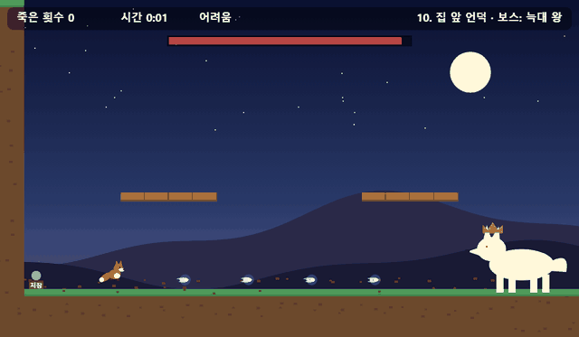
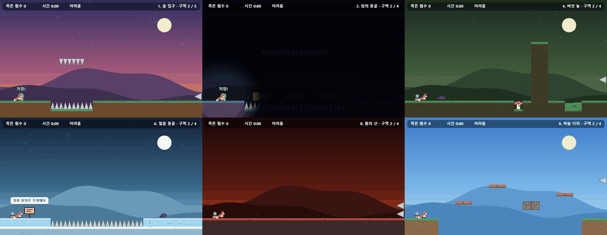
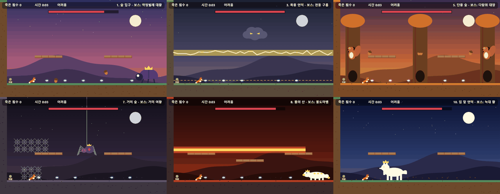

# 🦊 여우의 고난길

푸른 여우불을 쏘며 집으로 돌아가는 여우의 험난한 여정을 그린 **고난도 횡스크롤 플랫포머**입니다.
HTML5 Canvas와 순수 JavaScript로 만들었으며, 별도의 설치나 빌드 없이 브라우저에서 바로 실행됩니다.

곳곳에 숨겨진 함정을 피하고, 스테이지마다 다른 보스를 쓰러뜨리며 10개 스테이지를 지나 집까지 돌아가세요.



## 바로 플레이

👉 **https://qlqldks985.github.io/fox-hardcore/**

로그인하고 10스테이지를 처음부터 끝까지 깨면 클리어 기록이 **온라인 랭킹**에 올라갑니다.

## 실행 방법 (내 컴퓨터에서)

1. 이 저장소를 내려받습니다.
   ```bash
   git clone https://github.com/qlqldks985/fox-hardcore.git
   ```
2. `index.html` 파일을 브라우저(Chrome, Edge 등)로 엽니다. 더블클릭만 하면 됩니다.

## 조작법

| 키 | 동작 |
| --- | --- |
| `←` `→` (또는 `A` `D`) | 이동 |
| `Space` (또는 `↑`, `W`, `Shift`) | 점프 · 공중에서 한 번 더 누르면 2단 점프 |
| `Z` (또는 `X`, `J`) | 공격 (여우불 발사) |
| `R` | 마지막 저장 지점에서 다시 시작 |
| `P` / `Esc` | 일시정지 |
| `Enter` | 시작 · 계속 |
| `L` | 온라인 랭킹 보기 (타이틀 · 클리어 화면) |
| `M` | 효과음 끄기 / 켜기 |

**타이틀 화면**
- `←` `→` : 난이도 선택 (쉬움 / 어려움)
- `Enter` : 처음부터 시작
- `C` : 도달했던 스테이지부터 이어하기 (이어하기로 깬 기록은 최고 기록에 반영되지 않습니다)

모바일·터치 화면에서는 화면 아래 버튼(◀ ▶ ↺ 공격 점프)으로 조작할 수 있습니다.

## 난이도

| | 쉬움 | 어려움 |
| --- | --- | --- |
| 체력 | 하트 3개 (맞으면 1.5초 무적) | 한 번 맞으면 끝 |
| 낙사 | 마지막으로 밟은 안전한 땅으로 복귀 | 저장 지점부터 다시 |
| 함정 | 발동 4칸 앞에 `!` 경고 표시 | 경고 없음 + 어려움 전용 함정 |
| 가짜 바닥 | 반투명 + 점선 테두리로 표시 | 진짜 흙과 똑같이 보임 |
| 보스 | 체력 절반, 느린 공격, 긴 휴식 | 추가 패턴, 체력이 절반 이하면 빨라짐, 페이크 공격 |

최고 기록은 난이도별로 따로 저장됩니다 (브라우저 localStorage).

## 로그인 & 랭킹

- 게임 화면 위의 **로그인 / 회원가입** 버튼으로 아이디 · 닉네임 · 비밀번호를 정해 가입합니다. 어느 기기에서든 같은 아이디로 로그인할 수 있습니다.
- 10스테이지를 **처음부터** 끝까지 깨는 순간 기록이 자동으로 등록됩니다. (이어하기로 깬 판은 제외)
  로그인하지 않고 깼다면 클리어 화면에서 로그인하면 그때 등록됩니다.
- 순위: **클리어 시간이 짧을수록**, 같으면 **덜 죽을수록** 위. 난이도별로 따로, 한 사람당 최고 기록 하나만 표시됩니다.
- 서버는 [Supabase](https://supabase.com) (인증 + PostgreSQL)를 사용합니다. 테이블과 권한(RLS) 설정은 [`supabase/schema.sql`](supabase/schema.sql)에 있습니다.
- `js/config.js`의 `url`, `anonKey`를 비우면 로그인 · 랭킹 없이 혼자 하는 게임으로 동작합니다.

## 스테이지 & 보스

모든 스테이지에는 고유한 기믹과 함정 구역이 있고, 끝에서 그 스테이지만의 보스가 기다립니다.
보스의 공격은 모두 **가로 방향**으로 날아오며, 높이(낮게 · 높게 · 발판 위)에 따라 피하는 방법이 달라집니다.



| # | 스테이지 | 기믹 | 보스 |
| --- | --- | --- | --- |
| 1 | 숲 입구 | 기본 함정 구역 5개 | 딱정벌레 대왕 |
| 2 | 밤의 동굴 | 어둠 | 박쥐 여왕 |
| 3 | 폭풍 언덕 | 돌풍 | 천둥 구름 |
| 4 | 버섯 늪 | 독 늪 · 버섯 트램펄린 | 독두꺼비 |
| 5 | 단풍 숲 | 움직이는 / 떨어지는 낙엽 발판 | 다람쥐 대장 |
| 6 | 얼음 동굴 | 미끄러지는 얼음 | 얼음 고슴도치 |
| 7 | 거미 숲 | 거미줄 (느려지고 낮게만 점프) | 거미 여왕 |
| 8 | 불의 산 | 용암 · 간헐천 | 불도마뱀 |
| 9 | 하늘 다리 | 깜빡이며 사라지는 구름 발판 | 매 장군 |
| 10 | 집 앞 언덕 | 쫓아오는 늑대 무리 | 늑대 왕 |



## 프로젝트 구조

```
fox-hardcore/
├── index.html            # 게임 화면(캔버스), 터치 버튼, 로그인 · 랭킹 창
├── css/style.css         # 화면 스타일
├── js/
│   ├── levels.js         # 스테이지 지형 · 함정 · 저장 지점 정의 (STAGES)
│   ├── bosses.js         # 보스 10종 정의 (BOSS_TYPES, 상태 기계)
│   ├── core.js           # 설정값, 입력, 게임 상태, 기록 저장, 타일 충돌
│   ├── world.js          # 한 프레임 업데이트: 플레이어 물리, 함정, 총알, 적, 충돌
│   ├── boss-fight.js     # 보스 정의를 실제로 돌리는 부분
│   ├── render-world.js   # 그리기: 배경, 타일, 스테이지 기믹
│   ├── render-actors.js  # 그리기: 여우, 적, 보스, 투사체, 상단 표시줄, 메뉴
│   ├── main.js           # 메인 루프 (1/60초 고정 간격 업데이트 → 그리기)
│   ├── sound.js          # 효과음 (Web Audio로 즉석 합성, 소리 파일 없음)
│   ├── online.js         # 로그인 · 회원가입 · 랭킹 (window.FoxOnline)
│   └── config.js         # Supabase 주소와 공개 키
├── supabase/schema.sql   # 회원 · 기록 테이블, 랭킹 뷰, 권한(RLS)
├── tests/                # 브라우저 없이 게임을 돌리는 자동 테스트
└── docs/images/          # README 이미지
```

빌드 도구 없이 `<script>` 태그 순서대로 불러오며, 게임 스크립트들은 전역 스코프를 공유합니다.

## 테스트

```bash
npm test        # 또는 node --test
```

Node.js 20 이상만 있으면 됩니다 (설치할 패키지 없음). 캔버스와 문서를 가짜로 바꾼 환경에서 게임 로직을 1/60초씩 직접 돌려 확인합니다. 10분 분량의 보스전도 1초 안팎이면 끝납니다.

- 10개 스테이지가 두 난이도에서 에러 없이 돌아가고 그려지는지
- **보스 10종 × 2난이도**: 무적 봇이 여우불을 쏘며 싸워서 보스를 쓰러뜨리고, 출구 · 집으로 넘어가는지 (어려움 전용 패턴, 가짜 죽음 같은 억까 포함)
- 가짜 바닥은 밟을 수 없는지, 쉬움에서만 표시되는지
- 난이도별 피격 규칙 (어려움 한 번에 기절, 쉬움 하트 3개)
- 최고 기록 기준이 온라인 랭킹과 같은지 (시간 → 죽은 횟수, 이어하기 제외)

GitHub에 올릴 때마다 GitHub Actions에서 자동으로 실행됩니다.

## 기술 스택

- HTML5 Canvas
- Vanilla JavaScript (외부 라이브러리 없음)
- CSS3
- Web Audio API — 효과음
- Supabase (Auth, PostgreSQL, Row Level Security) — 로그인 · 랭킹
- Node.js 내장 테스트 러너 (`node:test`, `node:vm`) — 자동 테스트
- GitHub Pages — 배포
